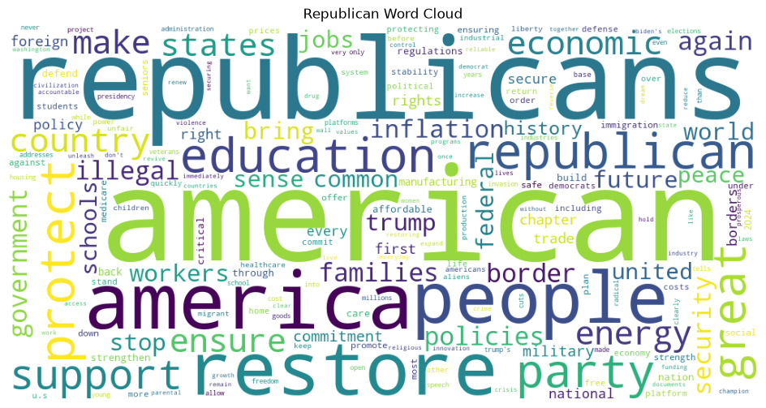
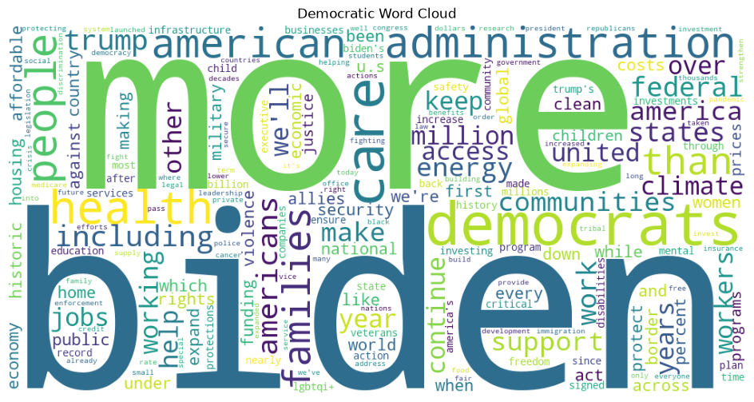
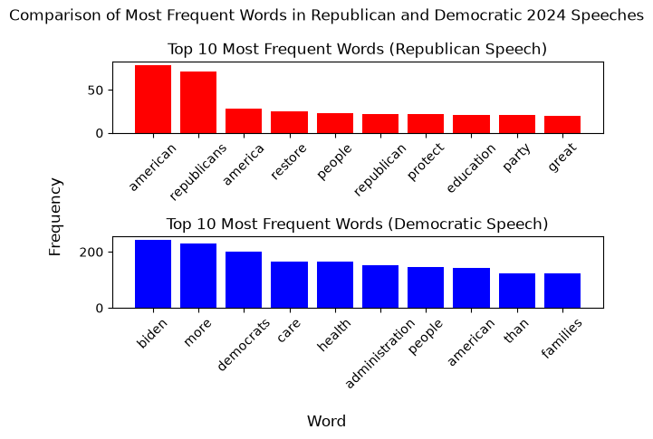

# nlp-01-getting-started-custom

[](pyproject.toml)
[](https://github.com/denisecase/nlp-01-getting-started/actions/workflows/ci-python-zensical.yml)
[](https://ajaneh.github.io/nlp-01-getting-started-custom/)

[](https://docs.astral.sh/uv/)
[](https://docs.astral.sh/ty/)
[](https://zensical.org/)
[](LICENSE)

> Retrieve, process, and visualize text from the web using Python.

## Project Overview

Author: Alex Heyert

Date: 2026 October

This is my customized first project for the Web Mining and Applied NLP course.
It explores word frequencies in the 2024 Democratic and Republican party
platforms, rather than analyzing a single example webpage.

## Data

The notebook retrieves the platform pages directly from
[The American Presidency Project](https://www.presidency.ucsb.edu/):

- [2024 Republican Party Platform](https://www.presidency.ucsb.edu/documents/2024-republican-party-platform)
- [2024 Democratic Party Platform](https://www.presidency.ucsb.edu/documents/2024-democratic-party-platform)

The analysis uses the page content retrieved when the notebook is run; it does
not require a separate local input dataset. The source note and links identify
where the text comes from.

## What I Made My Own

I adapted the project to compare two related documents and added visual
summaries for each platform, along with a chart for comparing frequent words.
The notebook contains the code and step-by-step implementation details.

## Approach

The analysis follows the same broad workflow for each platform:

- Retrieve the page text and parse it.
- Clean the text and count word frequencies.
- Visualize frequent words in word clouds and a comparison chart.

## Run the Project
Go to the [Notebook](notebooks/web_words_heyert.ipynb) if you want to run it yourself!

## Results

The analysis produces a word cloud for each platform and a bar chart comparing
frequent words. These visualizations provide an exploratory view of the words
used in the two documents; word frequency alone does not explain their context.

### Project Visualization





## Verification

Run the automated tests:

```shell
uv run python -m pytest
```

## Project Documentation

The [hosted documentation site](https://ajaneh.github.io/nlp-01-getting-started-custom/)
is published using Zensical and GitHub Pages.

The documentation site is used to present the project report,
covering such sections as data, methods, results, visualizations,
interpretation, and conclusions.

## CI/CD and GitHub Actions

This project includes continuous integration and continuous deployment (CI/CD)
to check project files and publish the docs.

GitHub Actions include:

- [CI: Python and Documentation Checks](https://github.com/denisecase/nlp-01-getting-started/actions/workflows/ci-python-zensical.yml)
- [CD: Documentation Deployment](https://github.com/denisecase/nlp-01-getting-started/actions/workflows/deploy-zensical.yml)

## Developer Reference

Follow the
[Professional Python Workflow Guide](https://denisecase.github.io/pro-analytics-02/)
for **detailed instructions and troubleshooting**.

### Initialize and Update the Python Environment

With the project open in VS Code, open a VS Code terminal.
Paste each command and hit Enter or Return after to run it.

```shell
uvx pup-clean --delete
uv self update
uv python pin 3.14
uv python install
uv lock --upgrade
uv sync
uv audit
```

### Set Up and Run Git Hooks

Set up and run the git hooks to perform
basic checks automatically before
any changes get pushed to GitHub.

In the VS Code terminal,
paste each command and hit Enter or Return after to run it.

```shell
uv add prek --dev
uv sync
uv run prek update --freeze --cooldown-days 7

git add -A
uv run prek run --all-files
# repeat if changes were made
uv run prek run --all-files
```

### Run Common Chores

Run linters, formatters, type checks, tests, and
build the documentation.

```shell
uv run ruff check . --fix
uv run ruff format .

uv run ty check
uv run python -m pytest
uv run python -m zensical build
```

### Git add-commit-push to GitHub

After making useful changes, save your work to GitHub.

```shell
git add -A
git commit -m "describe your changes in quotes"
git push -u origin main
```

## Developer Notes

- Use the **UP ARROW** and **DOWN ARROW** in the terminal to scroll through past commands.
- Use `CTRL+f` to find (and replace) text within a file.

## Developer Tools

This project uses professional Python tools to support development,
testing, documentation, and code quality.

- [uv](https://docs.astral.sh/uv/) - Python environments and dependencies.
- [Ruff](https://docs.astral.sh/ruff/) - Python linting and formatting, configured in [.ruff.toml](.ruff.toml).
- [ty](https://docs.astral.sh/ty/) - Python type checking.
- [pytest](https://docs.pytest.org/) - automated Python testing, configured in [.pytest.toml](.pytest.toml).
- [prek](https://prek.j178.dev/) - Git hooks and automated checks, configured in [prek.toml](prek.toml).
- [Zensical](https://zensical.org/) - project documentation, configured in [zensical.toml](zensical.toml).

## Links

- [Hosted Documentation](https://denisecase.github.io/nlp-01-getting-started/)
- [Professional Python Workflow Guide](https://denisecase.github.io/pro-analytics-02/)
- [Citation](CITATION.cff)
- [License](LICENSE)
